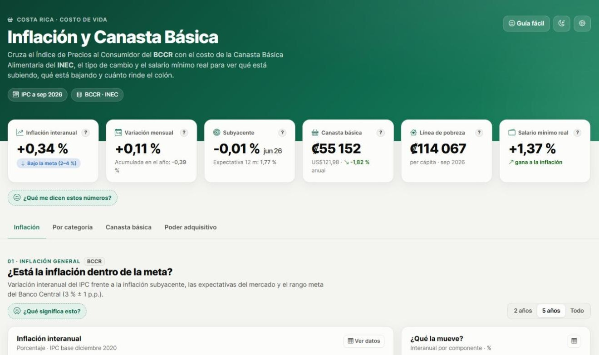
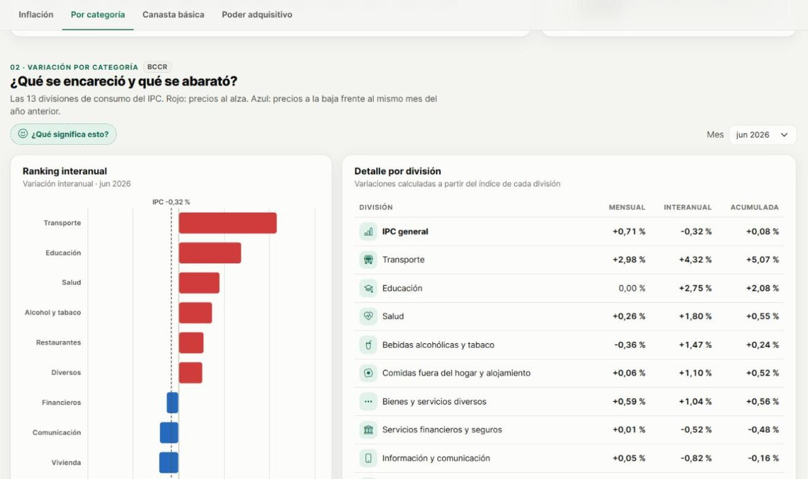
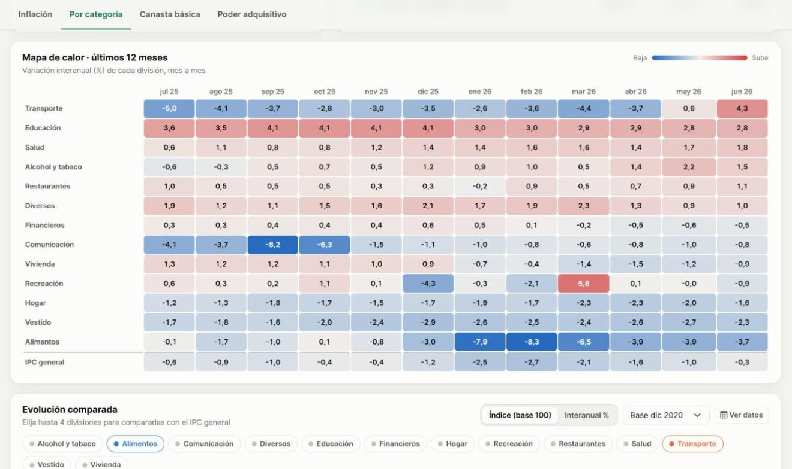
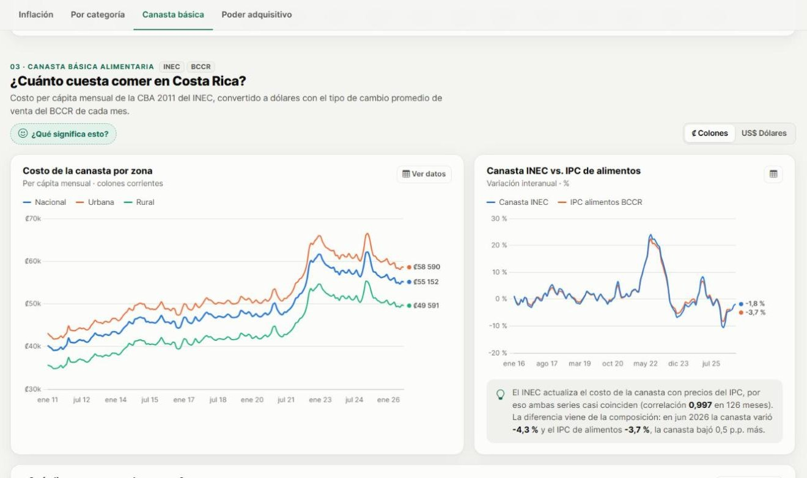
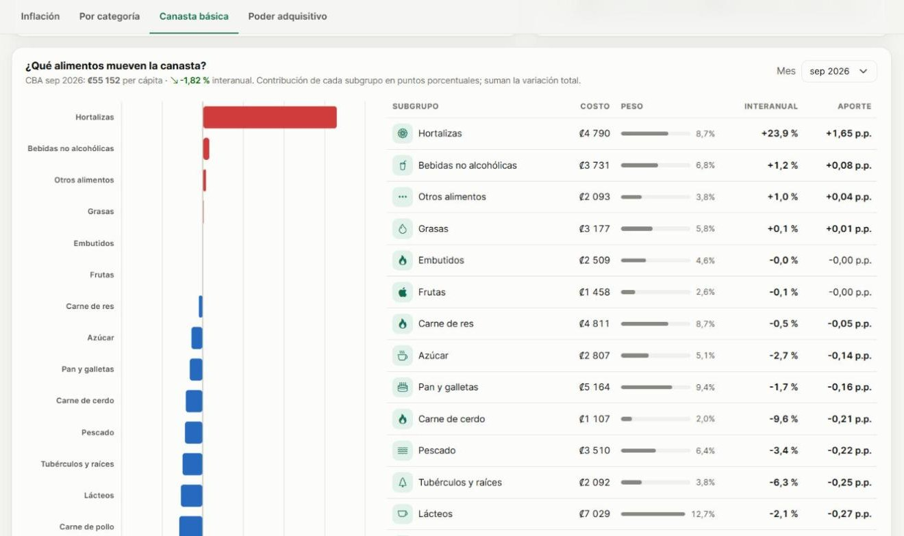

# 🧺 Canasta Básica CR · Inflación y costo de vida


Dashboard interactivo que responde dos preguntas simples con datos oficiales de Costa Rica:
**¿las cosas se están poniendo más caras o más baratas?** y **¿cuánto cuesta comer?**

En vez de mostrar una sola fuente, **cruza varias en un mismo análisis**: el Índice de Precios al Consumidor
del **Banco Central (BCCR)**, el costo de la **Canasta Básica Alimentaria del INEC**, el tipo de cambio y el
salario mínimo real.



---

## ✨ Qué hace

| | |
|---|---|
| 📈 **Inflación vs. meta** | IPC interanual frente a la inflación subyacente, las expectativas del mercado y el rango meta del BCCR (3 % ± 1 p.p.). |
| 🗂️ **Variación por categoría** | Ranking de las 13 divisiones de consumo, tabla mensual / interanual / acumulada y mapa de calor de 12 meses. |
| 🔀 **Evolución comparada** | Hasta 4 divisiones contra el IPC general, como índice (base a elegir) o variación interanual. |
| 🧺 **Canasta básica** | Costo per cápita por zona (nacional, urbana, rural) en **colones o dólares**, usando el tipo de cambio de cada mes. |
| 🥕 **¿Qué alimentos la mueven?** | Contribución de cada uno de los 17 subgrupos de alimentos a la variación de la canasta. |
| 💰 **Poder adquisitivo** | Calculadora de inflación y salario mínimo real: ¿el sueldo le gana a los precios? |
| 🙂 **Explicado fácil** | Guía, ayudas por sección y explicaciones de cada indicador **escritas automáticamente con los datos del mes**, en lenguaje que entendería un niño. |
| 🌗 **Accesible** | Tema claro/oscuro, paleta validada para daltonismo, tabla de datos en cada gráfico y diseño responsive. |

<table>
  <tr>
    <td></td>
    <td></td>
  </tr>
  <tr>
    <td></td>
    <td></td>
  </tr>
</table>

## 🔗 Fuentes de datos

| Fuente | Datos | Cómo se obtienen |
|---|---|---|
| **BCCR** · API SDDE | IPC general (cuadro 51), 13 divisiones (52), regulados/no regulados y bienes/servicios (53), inflación subyacente (680), salario mínimo real (792), expectativas de inflación (793) y tipo de cambio (1) | `php artisan canasta:sync`, programado a diario |
| **INEC** | Costo per cápita de la CBA 2011 por zona, 17 subgrupos de alimentos y líneas de pobreza (desde 2011) | Excel oficial de series históricas, importado desde el panel admin o por consola |

> El sitio del INEC bloquea descargas automáticas, por eso el Excel se descarga a mano y se importa.
> El importador lee directamente las hojas del archivo oficial, sin tener que convertirlo.

## 🧮 Metodología

Todas las variaciones se calculan a partir de los **niveles** de cada índice o monto, para que sean consistentes
entre fuentes (y se verificaron contra las publicadas por el BCCR):

```
mensual    = nivel(t) / nivel(t-1)               − 1
interanual = nivel(t) / nivel(t-12)              − 1
acumulada  = nivel(t) / nivel(diciembre previo)  − 1
```

**Contribución de un subgrupo a la variación de la canasta** (en puntos porcentuales):

```
aporte = (costo_subgrupo(t) − costo_subgrupo(t−12)) / CBA(t−12) × 100
```

La suma de los aportes es exactamente la variación interanual de la canasta. Así se puede decir, por ejemplo,
que *las hortalizas (+23,9 %) aportaron +1,65 p.p. mientras cereales y huevo la empujaron hacia abajo*.

**Canasta en dólares:** costo en colones ÷ promedio mensual del tipo de cambio de venta del BCCR.

## 🏗️ Arquitectura

```
BCCR (API REST) ──► BccrService ──► SincronizadorBccr ──┐
                                                         ├──► indicadores / observaciones (MariaDB)
INEC (Excel)  ──► CanastaImportService ─────────────────┘                 │
                                                                          ▼
                                                  InflacionService (cálculos + caché)
                                                                          │
                                       DashboardController ──► API JSON ──► jQuery AJAX ──► Chart.js
```

- **Modelo de datos genérico:** cualquier serie (de cualquier fuente) es un `indicador` con sus `observaciones`.
  Agregar un indicador nuevo del BCCR es una línea en `config/bccr.php`.
- **Caché versionada:** los cálculos se guardan en caché y se invalidan solos al sincronizar o importar.
- **Frontend robusto:** solo se dibuja la respuesta más reciente cuando hay clics rápidos, y los errores se
  muestran sin destruir el gráfico, con botón de reintentar.

## 🛠️ Stack

**Backend:** Laravel 13 · PHP 8.5 · MariaDB · PhpSpreadsheet · PHPUnit
**Frontend:** Bootstrap 5 · jQuery (AJAX) · Chart.js 4 · Bootstrap Icons

## 🚀 Instalación

```bash
git clone https://github.com/sebasgom0415/Canasta-Basica.git
cd Canasta-Basica
composer install
cp .env.example .env          # completar DB_*, BCCR_API_TOKEN y ADMIN_KEY
php artisan key:generate
php artisan migrate --seed
php artisan canasta:sync                                      # historial del BCCR desde 2015
php artisan canasta:importar-cba ruta/seEconomCBA....xlsx      # Excel del INEC
php artisan config:cache
```

- **Token del BCCR:** se solicita gratis en el [SDDE del BCCR](https://sdd.bccr.fi.cr/).
- **Excel del INEC:** [inec.cr › Costo Canasta Básica Alimentaria](https://inec.cr/tematicas/listado?topics=134,135),
  archivo *«Cuadros de series históricas de resultados de la CBA»*.
- **Actualización diaria:** programar `php artisan schedule:run` cada minuto.
- **Panel de administración:** `/admin` (clave `ADMIN_KEY`), para sincronizar el BCCR y subir el Excel del INEC.

> **XAMPP / Apache con PHP thread-safe:** ejecutar `php artisan config:cache` y repetirlo cada vez que cambie el
> `.env`. Sin la caché, las peticiones simultáneas pueden arrancar Laravel sin leer el `.env`, porque las variables
> de entorno se comparten entre hilos. Los tests usan su propia ruta de caché (`APP_CONFIG_CACHE` en
> `phpunit.xml`), así que nunca tocan la base real.

## 📁 Estructura

```
app/Services/BccrService.php           Cliente cURL del API SDDE del BCCR
app/Services/SincronizadorBccr.php     Descarga y guarda los cuadros configurados
app/Services/CanastaImportService.php  Lee el Excel del INEC (cuadros 1, 2 y 3)
app/Services/InflacionService.php      Cálculos y datos para cada gráfico
config/bccr.php                        Catálogo de indicadores y meta de inflación
resources/views/index.blade.php        Dashboard
resources/views/components/ayuda.blade.php  Explicaciones desplegables
public/assets/js/dashboard.js          Gráficos, AJAX y explicaciones dinámicas
tests/Feature/InflacionServiceTest.php Pruebas de cálculos y API
```

## ✅ Tests

```bash
php artisan test
```

Cubren el cálculo de variaciones, que los aportes de los subgrupos sumen la variación total, la calculadora de
poder adquisitivo, la validación de la API y la protección del panel admin.

---

Datos públicos del Banco Central de Costa Rica y del Instituto Nacional de Estadística y Censos.
Desarrollado por [sebasgom0415](https://github.com/sebasgom0415).
